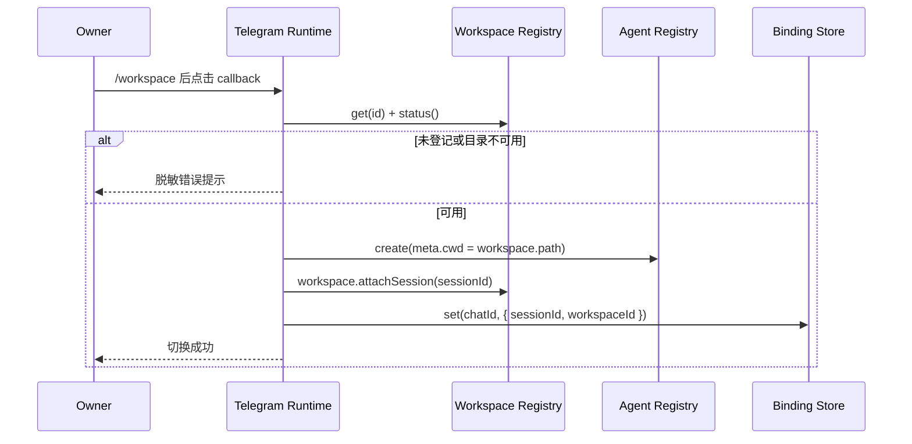

## Context

当前 Runtime 在启动时验证配置的默认 Workspace，并把每个聊天绑定持久化为 `{ sessionId, workspaceId }`，但 Session 创建、恢复和状态展示始终硬编码使用默认 Workspace。Telegram 客户端也未调用 `setMyCommands`，用户只能记忆命令。dsh 的正式 `workspaceRegistry` 契约提供同步 `list()`、`get(id)`，Workspace 提供 `id`、`title`、`path`、`status()` 和 `attachSession()`。

本次变更横跨 Telegram 客户端、Runtime、卡片和持久化路由，但不改变存储 schema，也不引入依赖。

## Goals / Non-Goals

**Goals:**

- 仅向配置的 Owner 私聊发布五个支持命令。
- 让 `/workspace` 展示选择卡片，并由 callback 进入统一的安全切换路径。
- 使当前绑定的 `workspaceId` 决定 Session 创建、恢复、`/new` 和 `/status` 行为。
- 对未知或目录不可用的 Workspace 失败关闭，不修改原绑定。

**Non-Goals:**

- 不通过 Telegram 创建、删除、重命名 Workspace。
- 不接受文件系统路径作为 Workspace 标识。
- 不迁移 Agent 流式正文到 Rich Message、Draft 或 Ephemeral Message。
- 不改变 Owner-only 私聊访问模型。

## Decisions

### 命令注册使用 Telegram 标准 scope

`createTelegramClient` 在 `getMe` 和 webhook 校验成功后、polling 启动前，依次清空并注册 `all_private_chats`、`all_group_chats` 和 `all_chat_administrators` 三个标准 scope。为清理 BotFather 或旧版本残留，还会删除 `default` scope 和配置 Owner 的 `chat` scope，防止回退菜单或更高优先级菜单覆盖标准 scope；这两个兼容 scope 只清理、不注册。命令展示范围与执行权限分离：Runtime 仍只处理配置 Owner 的私聊消息。相比在 Runtime 直接操作 SDK，客户端生命周期和 Bot API 初始化保持内聚。

### 绑定 Workspace 优先，配置 Workspace 回退

Runtime 通过当前绑定解析 Workspace；没有绑定时使用配置的 `workspaceId`。恢复时同时校验 Workspace 仍登记、目录可用且 Session cwd 匹配。旧绑定无需迁移，因为数据结构已包含 `workspaceId`。

### 统一切换事务

命令和 callback 都调用同一切换函数：先通过 `get(id)` 校验登记，再检查 `status()`，然后创建并 attach 新 Session，最后原子更新绑定，成功后释放旧句柄。更新绑定前失败不会破坏旧绑定。选择 callback 成功后清空原卡片按钮，防止重复提交。

### 普通 inline keyboard 保持兼容

Workspace 选择卡片继续使用现有 `sendMessage` 和 `InlineKeyboardMarkup`，callback data 使用 `dsh:workspace:select:<encoded-id>`。这条路径已被现有 Transport 和 callback 安全模型覆盖。Rich Message 的禁用按钮虽可改善完成态，但会扩大消息模型和降级测试范围，留待独立 change。

## Risks / Trade-offs

- [Workspace 数量过多会产生较长键盘] → 每个 Workspace 使用单独一行，依赖 Telegram 消息键盘上限；当前 dsh Workspace 为本地人工登记集合，不引入分页复杂度。
- [切换后旧 Agent 仍存在于 Host Registry] → 释放插件持有的句柄，沿用 `/new` 现有生命周期语义；不删除 Session 日志。
- [callback data 有 64 字节限制] → 正式 Workspace ID 为 UUID，当前编码格式低于限制；渲染时过滤无法安全编码进 callback 的异常 ID。
- [注册命令失败导致启动失败] → 将命令菜单视为连接初始化的一部分，失败时不启动 polling，避免客户端处于能力与菜单不一致状态。

## Migration Plan

1. 发布包含新 Runtime 和客户端逻辑的插件版本，无需数据迁移。
2. Runtime 重启后自动为 Owner chat 注册命令；现有默认 Workspace 绑定继续工作。
3. 回滚时恢复旧版本；非默认 Workspace 绑定会被旧逻辑清除并在默认 Workspace 新建 Session，Session 日志不会删除。

## Open Questions

无。
