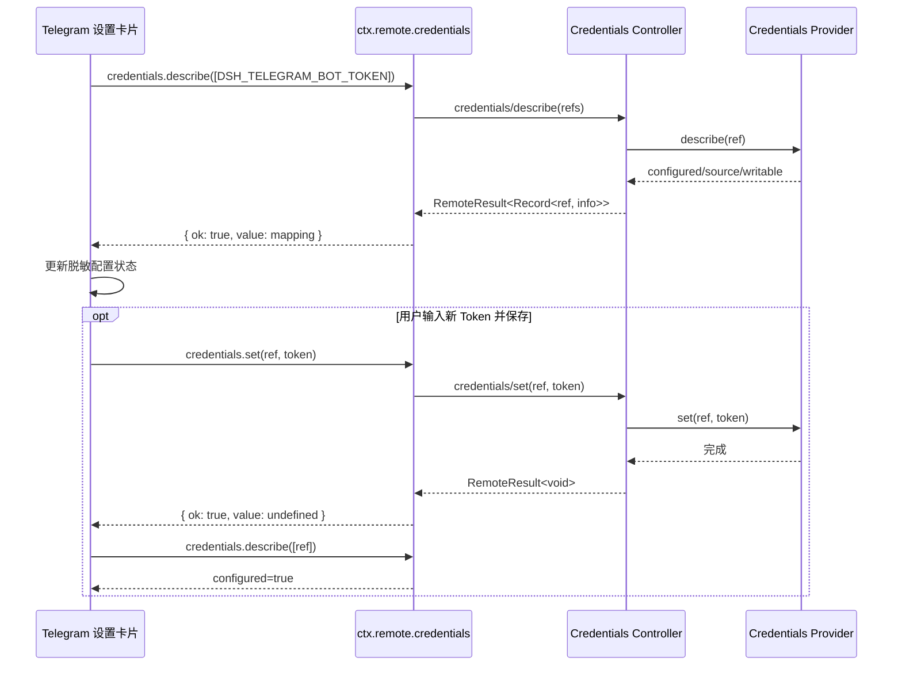

## Context

`dsh-telegram` 以安装到 dsh profile 的方式运行。包内 `package.json#dsh.bundle.patch` 指向 `cordis.patch.yml`，当前 dsh 会自动把已安装插件加入最终插件树；旧开发说明仍要求启动时额外传同一个 `--patch`，最终生成两个 `id: dsh-telegram`，Cordis loader 以 `duplicate loader entry id` 拒绝启动。

浏览器端设置卡片通过 dsh Remote service 读取 Bot Token 的脱敏状态并提交新 Token。当前实现仍从已移除的 `ctx.get('connection').api` 取 API、把参数包装为对象，并从 `response.result.value.credentials` 解包。dsh `0.1.5-rc.1` 将 credentials 客户端挂载为 `ctx.remote.credentials`，Typert 方法定义为 `describe(refs)`、`set(ref, value)`，返回值是 `{ ok, value }` 形式的 `RemoteResult`，成功值中的 credentials 直接按引用名索引。

现场验证表明 Host 的 `/api/credentials/describe` 正常返回 200，dsh 自带设置页可读取凭据；Telegram 卡片的调用在客户端严格参数校验阶段失败，因此没有产生包含 `DSH_TELEGRAM_BOT_TOKEN` 的请求。当前卡片又将所有异常统一替换为“无法读取 Telegram 凭据状态”，隐藏了失败阶段。

## Goals / Non-Goals

**Goals:**

- 使用 dsh `0.1.5-rc.1` 的 credentials Typert RPC 契约读取和写入 Telegram Bot Token。
- 确立已安装插件由包内 bundle patch 自动注册的单一来源，避免重复 loader id。
- 保持凭据值只从浏览器写向 Host，读取路径只返回 `configured`、`writable`、`source` 等脱敏元信息。
- 明确处理 `RemoteResult` 的成功和失败分支，并向页面提供不包含 Secret 的可诊断错误。
- 用客户端边界测试覆盖读取、保存和失败场景，避免仅靠 runtime mock 测试遗漏宿主契约变化。
- 当增量事件桥缺失时仍从已落入 Session 的最终 assistant 消息交付 Telegram 正文，且不重复已流式交付的内容。

**Non-Goals:**

- 不兼容 dsh 更新前的旧 credentials RPC 参数和响应结构。
- 不删除 `cordis.patch.yml`，也不移除 `package.json#dsh.bundle.patch`。
- 不改变 `DSH_TELEGRAM_BOT_TOKEN` 引用名、credentials 后端或已有 Secret。
- 不改变 Bot 连接、Workspace/Session 路由和普通 Settings 持久化；runtime 仅增加最终文本兜底。
- 不重构整个 Telegram 设置卡片或迁移到新的 UI 框架。

## Decisions

### 1. 已安装插件只由 bundle patch 自动注册

保留 `cordis.patch.yml` 及 `package.json#dsh.bundle.patch`，常规启动统一使用 `dsh web` 或 `dsh --profile web`，不再额外传 Telegram patch。该选择符合当前 dsh 的插件安装模型，也让发布包具备自描述注册能力。

显式 `--patch` 仍可用于插件未安装到 profile 的隔离开发场景，但不得与已安装插件同时使用。文档和验证命令必须明确这两个模式互斥。

替代方案是删除包内 bundle patch并始终要求 `--patch`。这会破坏通过 `dsh plugin add` 安装后的自动加载体验，也容易在不同 profile 中遗漏启动参数，因此不采用。

### 2. 直接采用当前 Typert 位置参数契约

客户端声明注入 `remote` 与 `remote.credentials`，从 `ctx.remote.credentials` 获得 API。读取调用使用 `credentials.describe(Object.values(refs))`，写入调用使用 `credentials.set(ref, value)`。不加入“先尝试新协议、失败后尝试旧协议”的兼容分支，因为严格客户端会在参数边界拒绝错误形状，双调用也可能使写入重试产生不明确结果。

替代方案是保留对象参数并绕过生成客户端直接请求 `/api`。该方案会复制 transport 细节、失去 Typert 校验，并使插件继续依赖非公开 wire 格式，因此不采用。

### 3. 在卡片边界显式解包 `RemoteResult`

`describe` 成功时直接读取 `response.value[ref]`；失败时根据 RemoteResult 的安全错误信息生成 UI 错误。`set` 也必须检查其 RemoteResult，而不能把 Promise 正常 resolve 等同于业务成功。错误展示只使用远程错误的公开消息或本地阶段描述，不序列化请求参数、响应对象或 Token。

替代方案是只依赖异常捕获。当前 API 将业务失败表示为 RemoteResult，单靠 `catch` 会把 `{ ok: false }` 当成成功，因此不采用。

### 4. 将 RPC 适配逻辑置于可测试边界

保持 UI 变更最小，但将“读取凭据状态”和“写入 Secret”的行为组织为可传入 API mock 的函数或同等可测试单元。测试断言位置参数、成功值映射、失败传播以及错误文本不含 Secret。构建后继续由 `src/client.js` 生成 `lib/client.js`，不手工维护两份不同逻辑。

### 5. 保持写入顺序与启用门禁

保存仍先暂时禁用已启用的 runtime，再写普通配置和 Secret，刷新凭据状态成功后才重新启用。这样 Token 写入失败时不会用不完整配置启动 runtime。此次只修正 credentials RPC，不改变现有保存事务边界。

### 6. 以 Session 最终消息兜底缺失的增量事件

Turn idle 后先排空 `StreamSession`；若本 Turn 已交付任何有效文本，不再处理最终正文。若没有流式正文，则从 `session.deriveMessages()` 取最后一条 assistant 消息，将其中的文本块送入同一 `StreamSession` 渲染路径。这样保留 HTML 转换、分片和纯文本降级，并覆盖 Session 已完成但 `session/event` 未送达的情况。

### 7. 升级 Telegram SDK 但保持现有交付语义

将 `node-telegram-bot-api` 精确固定为 `2.1.0`，获得 Bot API 10.3 及 rich/ephemeral message 等新增 API。当前修复继续使用 `sendMessage`、`editMessageText`、媒体和 reaction API，不在兼容修复中切换到 rich message 或 draft 协议，避免扩大行为变化。

### Sequence



插件启动配置关系：

```text
已安装到 profile
    │
    ▼
package.json#dsh.bundle.patch
    │
    ▼
cordis.patch.yml
    │
    ▼
唯一 id: dsh-telegram

启动命令：dsh web
禁止叠加：--patch ./packages/plugins/dsh-telegram/cordis.patch.yml
```

## Risks / Trade-offs

- [插件不再兼容旧 dsh credentials 客户端] -> 在包说明和测试中明确最低兼容契约；本变更以当前安装的 `0.1.5-rc.1` 为目标，不增加未经验证的双协议逻辑。
- [开发者仍沿用归档文档里的旧 `--patch` 命令] -> 新增当前使用说明，并以 `dsh --profile web --dump-config` 验证插件树中只有一个 `dsh-telegram`；归档 OpenSpec 作为历史记录不回写。
- [远程错误消息可能包含实现细节] -> UI 只展示允许的公开 message，并以固定阶段文案兜底；测试确保错误中不包含提交的 Token。
- [只更新源码但遗漏发布产物] -> 任务要求运行现有客户端构建并检查 `lib/client.js` 同步更新。
- [缺少真实浏览器集成会再次遗漏参数形状] -> 除单元测试外，在本地 dsh 设置页验证请求体包含 `refs` 数组并成功返回 Bot Token 脱敏状态。
- [最终消息兜底与流式内容重复] -> `StreamSession` 持久记录本 Turn 是否已产生有效正文，仅在没有流式正文时启用兜底，并以回归测试锁定。

## Migration Plan

1. 更新当前插件使用说明，明确已安装模式直接运行 `dsh web`，显式 patch 仅供未安装模式使用。
2. 更新客户端 credentials 调用及 RemoteResult 解包。
3. 增加客户端契约测试并重新构建 `lib/client.js`。
4. 运行插件测试，用 `--dump-config` 确认单一 loader id，并在 dsh `0.1.5-rc.1` 设置页验证读取和保存流程。
5. 发布包含修复的新插件版本后，现有 profile 更新插件并正常启动；已有 Bot Token 无需迁移。

回滚时恢复上一版插件客户端、构建产物和对应启动说明。回滚不删除、不重写 credentials 文件；若回滚目标使用旧 dsh，则由旧客户端继续读取同一个 `DSH_TELEGRAM_BOT_TOKEN` 引用。任何版本都不得同时通过 profile bundle 与命令行 `--patch` 注册同一 loader id。

## Open Questions

无。当前 dsh 的 Typert 声明、网络响应和设置页行为已足以确定目标契约。
