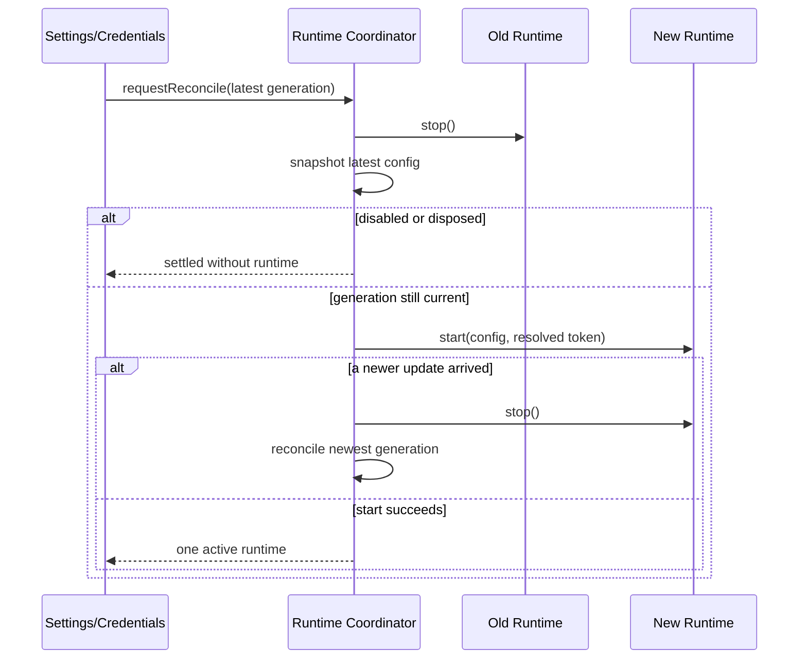
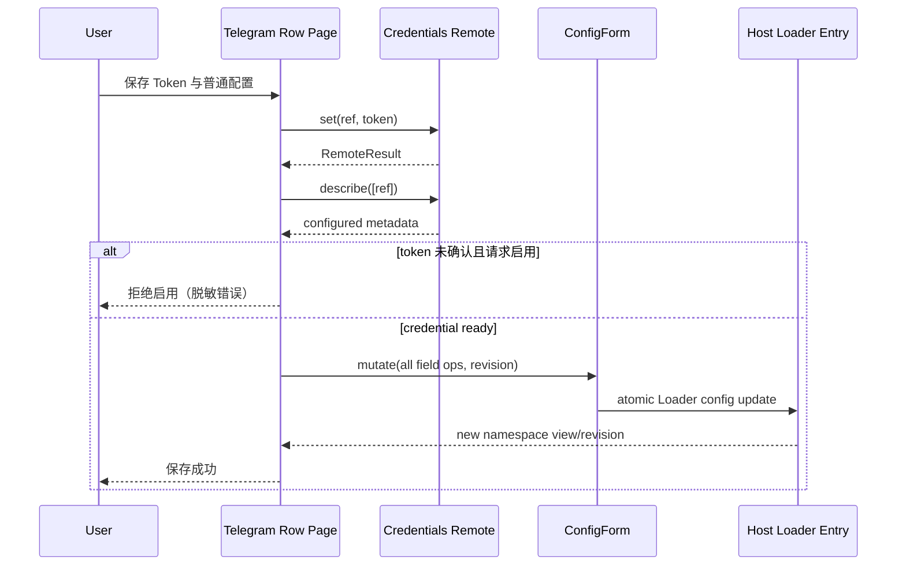
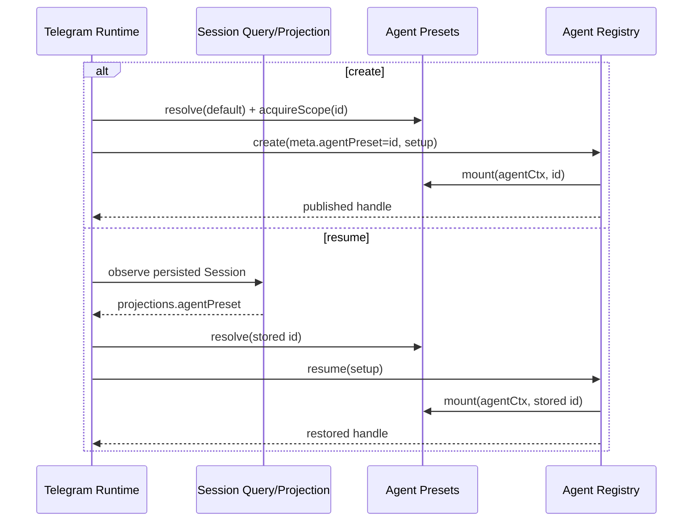

# Design

## Context

参见 `proposal.md` 的升级动机。当前插件运行时直接消费 `ctx.settings.register/get/watch`，浏览器端依赖 `settingsScope` 与 `settings.plugin.item`；这些契约在 dsh `0.2.0-rc.2` 中已不存在。新版 Settings 以 Loader entry Config 为事实来源，通过 `configForms` 暴露带 revision 的客户端写入；插件配置页属于 Plugin Manager 的 row 扩展。

运行时已经自行创建/恢复 Agent，并在 setup 中挂载默认 preset。dsh `0.2.0-rc.2` 要求模型可见的 preset 组合与 Session log 一致：创建 header 记录初始 preset，恢复使用 `agentPreset` projection，而非当前默认值。Telegram binding 当前是 version 1 的 single-layout storage domain，升级必须保持原版本以避免全量文档 version mismatch。

## Goals / Non-Goals

**Goals:**

- 让 Host、Web 配置页和 Agent 生命周期严格使用 dsh `0.2.0-rc.2` 的公开契约。
- 配置及凭据热更新期间保持单 Bot 单 polling 客户端，并最终收敛到最新配置。
- 保证新 Session 的 preset 可审计、恢复 Session 的工具与提示组合不漂移。
- 保持现有绑定、credentials 和用户侧 Telegram 行为兼容。
- 让测试直接约束目标版 dsh 的接口形状，而不只依赖旧版 mock。
- 最终验收通过 `dsh web` 启动 web profile，并在不绑定所有接口的前提下允许受信局域网浏览器访问。
- 验收只加载当前工作区构建产物，不发布插件或从 registry 安装待发布版本。

**Non-Goals:**

- 同时兼容 dsh `0.1.5-rc.1` 与 `0.2.0-rc.2`。
- 新增 Telegram 命令、Bot、多 Owner、Webhook 模式或新的媒体类型。
- 为 binding 创建新 storage domain 版本或主动重写历史数据。
- 在本次升级中增加 Telegram 内的 preset 选择命令；只保证已选 preset 的创建与恢复语义正确。
- 改写 dsh 内置 Plugin Manager、Settings 或 preset registry。
- 支持公网暴露、反向代理、端口转发、动态 DNS 或为 dsh Web 增加新的认证机制。
- 在本 change 中执行 npm/pnpm publish，或用 registry 安装替代本地被测包。

## Decisions

### 决策 1：以 Loader entry Config 作为唯一普通配置来源

`Config` 的所有在线可编辑字段标记为 `volatile`。`apply(ctx, config)` 不再注册插件私有 settings namespace，而是直接使用 Loader 解析后的 config；存在 `ctx.settings` 时通过 `settings.configure({ auto: false })` 禁用自动生成页，由自定义配置页接管展示。

插件监听 scoped `loader/volatile-update`，收到更新后读取已就地更新的 config 对象并请求 runtime 协调器重建。监听 `credentials/reference-updated`，仅当 ref 为 `DSH_TELEGRAM_BOT_TOKEN` 时发起同样的重建。启用状态为 false 时协调器只停止现有 runtime，不创建新实例。

替代方案：依赖 Loader 卸载并重新 apply。该方式无法保证 volatile 更新会重建插件 fiber，也无法覆盖 Token-only 更新，因此不采用。保留旧 `settings.register` 的兼容层也不可行，因为目标版服务已移除该 API，且会形成两份配置事实源。

### 决策 2：用单一串行协调器管理 runtime generation

配置和凭据事件只负责增加 generation 并调度 reconcile，不直接并发调用 `start/stop`。协调器维护一条 promise tail；每轮先停止当前 runtime，再快照最新 config，并仅在 generation 仍为最新且插件未 disposed 时启动。若重建期间又收到更新，当前轮完成清理后继续下一轮，最终收敛到最新状态。

卸载时设置 disposed 标志、增加 generation、等待 tail 和当前 runtime 清理。启动失败只记录脱敏错误并保持无活动客户端，后续配置/凭据更新仍可触发重试。



替代方案：对更新做固定时长 debounce。它只能降低并发概率，不能提供停止顺序和卸载屏障，因此不采用。

### 决策 3：将配置页注册到 package row，而不是旧 Settings 列表或官方插件页

客户端注入图改为 dsh `0.2.0-rc.2` 的 `dsh-api-remotes`、`dsh-api-workspace-controller`、`dsh-client-ui-settings` 和 `dsh-client-ui-plugin-manager`。页面以 key `@implementsio/dsh-telegram#dsh-telegram` 注册到 `plugins.row.config`；Plugin Manager 在 row 详情页把 Host 已解析的 `ConfigPageForm { state, mutate }` 作为 owner prop 传给组件，插件必须直接消费它，不得再注入同名 `form` 覆盖 owner prop。

页面在 `view: summary` 返回简短用途说明，在 `view: page` 渲染完整表单。Workspace 继续读取 `ctx.workspaces.list`。非敏感字段通过 owner form 的 `mutate(...)` 一次原子提交并携带 `form.state.revision`；Token 仍走 `ctx.remote.credentials`，先写 Token、重新读取 configured 状态，再提交启用配置。任何失败都不回显 Token。非 loopback 页面由 dsh 将 ConfigForm 强制降为 memory 模式，因此配置必须在本机 loopback authority 完成，LAN authority 只用于配置后的功能验收。



替代方案：注册到 `settings.plugins.tab` 或 `plugins.item`。前者属于 Settings 的插件总览 tab，后者用于官方独立插件页面；本包是可安装 bundle，且配置精确归属于其中的 Loader row，`plugins.row.config` 的导航、开关和卸载关系最准确。

### 决策 4：preset ID 在 resolve、Session metadata 与 mount 之间保持同一来源

创建 Session 前调用 `agentPresets.resolve(undefined)` 得到确定 preset ID，并在创建事务期间通过 `acquireScope(id)` 持有 revision。`agents.create` 的 `meta.agentPreset` 和 setup 内 `agentPresets.mount(agentCtx, id)` 使用同一个 ID；Agent 成功发布或创建失败后释放 lease。

恢复前需要获得 Session 当前 preset。优先从已加载 Session 的 `ctx.sessionProjections.stateOf(session, 'agentPreset')` 读取；持久 Session 尚未加载时，通过注入 `sessionQuery` 获取 observation 并读取 `observation.projections.values.agentPreset`，然后再 `agents.resume`。恢复路径 resolve 并 mount 该历史 ID。若旧 Session 没有 projection，则回落当前默认 preset；若历史 preset 已删除或不可用，resume 失败并沿用现有失效绑定重建策略，新 Session 使用当前默认 preset。

复用 `ctx.agents.get()` 返回的 live Agent 时不重新 mount preset；它已拥有原 scope，只补装 Telegram bridges 和模型 selection，并用 `agentPresets.composedPreset(agent.ctx)`/projection 作一致性断言或测试观察。



替代方案：resume 时始终 mount 当前默认 preset。该方案会让模型看到的工具/提示与 durable log 不一致，违反 dsh `0.2.0-rc.2` 的 projection 契约，因此不采用。

### 决策 5：完整传播 ModelSelection，但保持 binding domain version 1

模型选择归一化为 `{ provider, model, reasoningEffort? }`。从 binding、全局默认和 live ref 读写时均保留 optional `reasoningEffort`，并传给 `agentOptions` 与 `installModelSelection`。`/model <provider> <model>` 没有 effort 参数，因此切换时不沿用旧模型 effort，而是省略它，让新模型使用自身默认值。

binding schema 只增加 optional 字段，不 bump `telegram_bindings` version。旧记录继续通过校验，新字段也不会要求主动迁移。原因是该 domain 使用 single layout，版本变化会让整个文档被 backend 拒绝，`compatibleVersions` 无法解决。

替代方案：不保存 reasoning effort。这样从全局默认继承时会静默改变用户选择，且无法完整表达目标版 dsh 的模型配置，因此不采用。

### 决策 6：运行时依赖精确对齐目标版，测试增加真实契约层

直接导入的 `@deepseek-ai/dsh-agent`、`@deepseek-ai/dsh-storage-domain` 及新增的客户端契约包精确锁定到 `0.2.0-rc.2`；Schemastery 对齐目标版兼容版本。插件进入 `1.x` 版本线，版本格式为 `<plugin-core>-dsh.<exact-dsh-version>`，并以 `engines.dsh` 重复声明机器可读的精确兼容目标；README 明确该映射规则与旧 dsh 不兼容边界。

保留现有纯单元测试，同时增加三层验证：

1. 对新 Host 配置协调器和客户端 ConfigForm 的契约测试；
2. 使用目标版真实 package exports 验证 Agent/storage API 和客户端 manifest 注入项可解析；
3. 通过 `dsh --profile web --dump-config` 与临时 profile/patch 做插件单次注册和 Loader schema smoke test，不读取或写入真实 Telegram Token。

不在测试中发起真实 Telegram 网络请求；真机 Bot 验证仍作为发布前手测。

### 决策 7：经批准使用临时 all-interface overlay 完成 LAN 验收

`dsh web` 是 `dsh --profile web` 的标准别名，最终集成与人工配置均使用它。实测目标版存在约束冲突：CLI 拒绝 `--host 0.0.0.0`，webserver schema 又只接受 `127.0.0.1 | 0.0.0.0`，因此无法绑定明确 LAN IP。用户已明确选择高风险方案：在批准的临时目录创建一次性 Loader overlay，按 id 覆盖 `webserver.config.host=0.0.0.0`，不修改 `profiles/web` 或仓库。

```bash
dsh --profile web --patch <temporary-overlay.yml> --port 3080 --trusted-host 192.168.1.106:3080 --no-open
```

该 overlay 绕过 CLI 对 all-interface 绑定的安全保护，会让具备 Agent/工具执行能力的 Web 服务监听所有 IPv4 接口。它仅允许在用户明确授权的短时验收窗口使用：不得配置公网地址或路由器端口转发，必须使用 Web token URL 和匹配的 trusted authority，结束后立即停止进程并删除 overlay。`--trusted-host` 只提供浏览器 Host/authority 防护，不是网络访问控制。

Bot Token、Owner ID 和 Workspace 由用户在 LAN 浏览器打开 Plugin Manager 后手动配置。自动化阶段不得要求用户在聊天中提供 Token，也不得把 Token 写入命令、环境日志、profile patch 或测试夹具。

替代方案：默认 loopback 或 SSH 隧道更安全，但用户明确选择临时 all-interface 方案；等待 dsh 修复明确 LAN IP 支持会阻塞本次验收。

### 决策 8：通过 dsh 转发的 `pnpm link` 安装本地验收包

验收前先运行插件测试和 `pnpm -F @implementsio/dsh-telegram build`，确保 `lib/client.js` 与当前源码一致。随后使用绝对路径把包链接到 web profile：

```bash
dsh plugin --profile web link /absolute/path/to/packages/plugins/dsh-telegram
```

dsh 的 plugin 子命令会把剩余参数原样转发给 pnpm，并以 `$DSH_HOME/profiles/web` 为目标 profile，因此无需手工 `cd` 或直接编辑 profile `package.json`。链接后必须验证：profile 依赖包含 `@implementsio/dsh-telegram`、实际解析路径指向当前仓库、包内 `dsh.bundle.patch` 自动产生且只产生一个 `dsh-telegram` row。目标版 dsh 实测允许两个同 id row 同时启动，因此验收脚本必须先检查 `--dump-config` 数量并在不等于一时主动失败；启动时不得再传本地 `cordis.patch.yml`。

link 是验收环境变更：执行前记录 `profiles/web/package.json`、lockfile（若存在）和 link 目标；验收结束先停止 `dsh web`，再执行：

```bash
dsh plugin --profile web unlink @implementsio/dsh-telegram
```

清理后比较 link 前状态，只撤销本次 link。若 profile 在 link 前已安装 registry 版插件，`pnpm unlink` 可能尝试恢复该依赖并访问 registry；实施时应根据记录验证恢复结果，不得删除用户原有依赖。`npm link` 仅在 pnpm link 被目标环境证实不可用时作为人工备选，不与 pnpm link 混用；采用备选前需更新验收记录和清理命令。

验收阶段明确禁止 `npm publish`、`pnpm publish` 和 `dsh plugin --profile web add @implementsio/dsh-telegram@<待发布版本>`。发布属于验收通过后的独立流程，不是本 change 的实施或验收任务。

替代方案：先发布 prerelease 再安装。它会把未经验收的包写入 registry，增加撤回和版本污染成本，因此不采用。直接使用命令行 `--patch` 虽不改 profile 依赖，但绕过了真实安装包 manifest 和 client inject 解析，不能覆盖本次升级的关键验收面。

### 决策 9：按配置协议使用固定代理 Agent

Telegram transport 不使用会从进程 `HTTP_PROXY`/`HTTPS_PROXY` 环境动态选路的通用 `proxy-agent`。`socks5` 配置直接创建 `SocksProxyAgent`，并映射为 `socks5h` 让代理端解析 Telegram 域名；`http`/`https` 配置直接创建 `HttpsProxyAgent`。这保证插件设置是唯一代理事实源，避免 dsh 启动环境覆盖页面配置，也避免本地 DNS 解析结果无法通过代理路由。

## Risks / Trade-offs

- [目标版多个 `@deepseek-ai/*` 包版本不一致会形成重复 Cordis/Agent 服务图] → 对直接 dsh 包精确锁版本，安装后检查 lockfile peer resolution，并在目标版 profile 做加载 smoke test。
- [配置和 Token 连续更新导致新旧 polling 重叠] → 所有触发源进入同一 generation-aware 串行协调器，启动前和启动后都检查新 generation，卸载等待 tail。
- [Token 写入成功但普通配置因 revision 冲突失败] → Token 保持安全可用但不自动启用；页面刷新最新配置并提示重试。credentials 与 Loader config 无跨服务事务，选择安全的先凭据后启用顺序。
- [历史 preset 已从部署移除] → 不伪造历史组合；报告恢复失败并按既有策略使绑定失效、使用当前默认 preset 创建新 Session。
- [为读取持久 Session preset 增加 `sessionQuery` 依赖面] → 只用官方 observation/projection，不解析 JSONL 或复制 projection fold；将该依赖纳入 inject 与契约测试。
- [Plugin Manager row key 与实际 bundle/row id 不一致导致页面不可见] → key 由 package name 和 `cordis.patch.yml` 的稳定 row id 派生，并以真实目标版 Plugin Manager smoke test锁定。
- [新增 optional reasoning effort 被旧插件忽略] → domain version 保持 1，回滚时旧 Zod schema剥离未知字段，不影响 provider/model。
- [npm registry 暂时不可达，无法立刻刷新 lockfile] → 实施时先确认 registry 可用并从目标版已发布 metadata 安装；禁止手工拼装 lockfile。
- [LAN 地址经 DHCP 变化导致 trusted host 不匹配] → 每次验收前重新探测地址，显式传当前 IP/端口给 `--trusted-host`，不在仓库中硬编码。
- [all-interface 绑定使其它网络接口也可访问具备工具执行能力的 dsh Web] → 仅在用户已批准的短时窗口使用临时 overlay，不做公网转发，使用 token URL，验收结束立即停止并删除 overlay。
- [pnpm link 的 peer 解析与发布安装不同] → 依赖版本仍精确锁定，link 后检查 profile 的实际解析图，并以 package exports 和 `--dump-config` 双重验证；发布前另做 pack 内容检查。
- [unlink 意外恢复或移除用户原有插件依赖] → link 前记录 profile 依赖与解析目标，停止进程后清理，只接受恢复到记录状态的结果，不使用覆盖式 package.json 操作。
- [源码修改后忘记重建已提交的 client bundle] → 每次 link 前强制运行 build，并检查 `lib/client.js` 与工作树状态；不依赖 link 自动执行 prepack。
- [目标版 dsh 不拒绝重复 loader id，两个 Telegram runtime 可能同时 polling] → LAN 启动前解析 `--dump-config`，要求 `id: dsh-telegram` 恰好出现一次；重复时由验收流程主动失败并移除额外 patch。

## Migration Plan

1. 完成目标版依赖升级、单元测试和契约测试；自动化测试不使用真实 Token，也不执行 publish。
2. 构建 `lib/client.js`，记录 web profile 当前依赖状态，并停止可能消费同一 Bot 的旧 dsh 进程。
3. 通过 `dsh plugin --profile web link <absolute-package-path>` 安装当前工作区包；验证实际解析路径后，用 `dsh --profile web --dump-config` 确认只有一个 Telegram row 且客户端依赖图可解析。
4. 备份 web profile 配置和 `telegram_bindings` 文件，动态探测受信 LAN IPv4；经用户授权后用临时 overlay 设置 `webserver.host=0.0.0.0`，并通过 `dsh --profile web --patch <overlay> --port <port> --trusted-host <lan-ip>:<port> --no-open` 启动。
5. 暂停自动流程，由用户在 LAN 浏览器的 Plugin Manager 中手动配置 Bot Token、Owner、Workspace 和可选 Proxy；Token 不进入聊天或测试日志。
6. 用户确认配置完成后，继续验证配置读取/保存、旧 binding、Session preset 恢复和单一 polling 客户端。
7. 真机验证文本流、`/new`、`/workspace`、`/model`、审批、提问、图片和 Token-only 更新。
8. 停止 LAN Web 进程，删除临时 overlay，unlink 本地插件并验证 web profile 恢复 link 前状态；发布留给独立后续流程。

回滚时先禁用或停止目标版进程，再成套恢复旧 dsh 与旧插件；保留 credentials 和 binding 文件。不得同时启动两个版本消费同一 Bot。若目标版曾写入 reasoning effort，旧插件会忽略该 optional 字段，数据文件无需降级转换。
