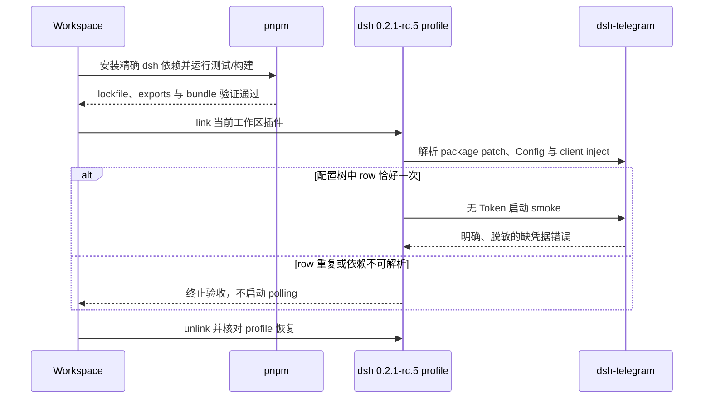

# Design

## Context

参见 `proposal.md`。当前插件的包版本、`engines.dsh`、六个直接 dsh 依赖、README 和规范都精确指向 `0.2.0-rc.2`。运行时直接使用 Agent、Session、LLM、preset、storage、credentials、Loader Settings 和客户端 ModuleLoader/slot 契约，因此不能只修改 `engines.dsh`。

npm 已发布目标版 `@deepseek-ai/dsh@0.2.1-rc.5`，其组成包继续使用精确同版本 peer 关系；已检查的 `dsh-agent`、`dsh-storage-domain`、`dsh-api-remotes`、`dsh-api-workspace-controller`、`dsh-client-ui-settings` 和 `dsh-client-ui-plugin-manager` 均存在 `0.2.1-rc.5` 版本及所需公开 export。仓库没有 dsh-telegram 包级 `AGENTS.md`，因此适用根 `AGENTS.md`、`docs/4-ci-cd.md` 和 `docs/5-release.md`。

## Goals / Non-Goals

**Goals:**

- 用真实 `0.2.1-rc.5` package exports 和 profile smoke 证明兼容，而非只让旧 mock 通过。
- 保持 Telegram 的现有可观察行为和 `telegram_bindings` domain version 1。
- 保持所有直接 dsh 包为同一精确版本，并使版本后缀可机器校验。
- 找出 `0.2.1-rc.5` 相对当前调用面的实际 API 差异，只修改受影响适配层和测试。

**Non-Goals:**

- 同时兼容 dsh `0.2.0-rc.2` 与 `0.2.1-rc.5`。
- 新增 Telegram 命令、媒体类型、认证主体或配置项。
- 迁移、重写或提升 `telegram_bindings` 数据版本。
- 修改 dsh 上游包、目标 profile 的永久配置或发布 npm 包。
- 将真机 Bot、真实 Token 或 LAN 暴露纳入无人值守测试。

## Decisions

### 决策 1：升级所有直接 dsh 契约包，不混用预发布版本

`package.json` 中 `@deepseek-ai/dsh-agent`、`@deepseek-ai/dsh-storage-domain` 和四个 `dsh.client.inject` 对应包全部精确锁定为 `0.2.1-rc.5`，`engines.dsh` 同步为该值。安装使用 pnpm 正常解析并生成 lockfile，不手工拼接 lockfile。

备选方案是只改 `engines.dsh` 或允许 `^0.2.0`。这会让 Agent/storage/client peer graph 混入不同预发布版本，不能证明 Cordis 服务身份和 API 形状一致，因此不采用。

### 决策 2：先以真实导出和失败测试定位差异，再做最小适配

保留 package-contract 测试对公开导出的直接导入，并把目标版本加入版本后缀、依赖一致性和 client inject 解析断言。安装后先运行现有测试和构建，按失败位置分别检查：

- Host：`installModelSelection`、storage domain、Agent create/resume、preset resolve/mount、Session projection、事件和审批 waterfall；
- Client：credentials RPC、Workspace remote、ConfigForm owner props、`plugins.row.config` slot 和 ModuleLoader wrapper；
- Bundle：`cordis.patch.yml` 单次注册、客户端 external 和生成产物加载。

只有真实 `0.2.1-rc.5` 契约证明调用面改变时才调整适配代码。备选方案是预先重写运行时或新增兼容 wrapper；这会扩大范围并掩盖根因，不采用。

### 决策 3：保持 Session/binding 语义和存储版本不变

此次宿主升级不改变 Telegram binding 的字段或含义。`telegram_bindings` 继续使用 single layout version 1；创建和恢复 Session 仍以持久化模型选择及 preset projection 为来源。若新宿主 API 需要调用形状变化，只在边界适配，不进行数据迁移。

备选方案是随宿主版本提升 domain version。single layout 会把版本不匹配视为整份文档不可读，而本次没有数据契约变化，因此该方案会制造无必要的数据中断。

### 决策 4：插件版本进入 `2.0.0-dsh.0.2.1-rc.5`

宿主精确兼容边界发生变化，按仓库版本规则将 plugin core 从 `1.0.0` 提升到 `2.0.0`，后缀编码目标 dsh 版本。测试继续要求 `version` 后缀、`engines.dsh` 和直接 dsh 依赖完全一致。该动作只更新版本来源，不代表执行发布。

备选方案是继续 `1.x` 或只替换后缀。当前仓库将宿主不兼容切换视为公开兼容契约变化，MAJOR 能让消费者明确区分两套宿主组合。

### 决策 5：验收分自动化和本地 profile 两层

自动化先运行包测试、客户端构建和根级 Node 门禁，不连接 Telegram。随后在已安装 `@deepseek-ai/dsh@0.2.1-rc.5` 的 web profile 中，通过包管理入口 link 当前工作区包，执行 dump-config 与无 Token 启动失败路径 smoke，确认单一 row、schema、client inject 和明确缺凭据错误。

不默认执行 LAN 监听或真机 Bot 验收。它们涉及网络暴露和真实凭据，必须另获明确授权。dsh `0.2.1-rc.5` 支持 `--host <lan-ip>` 绑定具体本地接口并拒绝 wildcard 地址，因此不再使用旧版 `0.0.0.0` 临时 overlay。备选方案是发布 prerelease 后安装；这会在验证前污染 registry，因此不采用。

## Risks / Trade-offs

- [上游 `0.2.1-rc.5` 某些服务保留 export 但改变运行时语义] → 使用现有行为测试、真实 package export 测试和 profile smoke 三层覆盖。
- [pnpm peer 解析残留 `0.2.0-rc.2`] → 检查 dsh-telegram importer 与相关 peer snapshots，不接受混合核心图。
- [客户端 bundle 源码通过但提交产物仍旧] → 修改后运行包 build，并由 ModuleLoader 测试加载 `lib/client.js`。
- [宿主升级误触 binding 迁移或 Session 漂移] → 保持 domain version 1，并回归旧 binding、模型继承和历史 preset 恢复。
- [profile link 改变用户现有依赖] → link 前记录状态，停止进程后操作，验收结束 unlink 并比较，只撤销本次变更。
- [缺真实 Bot 无法证明 Telegram 网络端到端行为] → 自动化只声明 Host/插件兼容证据；真机验收单独记录，不能用 mock 冒充。
- [npm 包仍为 rc，后续可能再次破坏契约] → 精确锁版并在每次目标版本变化时重复契约验证。

## Migration Plan

1. 更新精确依赖和版本映射，运行 pnpm 安装；检查目标 importer 不混入 `0.2.0-rc.2` dsh 核心包。
2. 让真实 package-contract 测试先约束 `0.2.1-rc.5`，运行插件测试与构建，根据失败做最小 API 适配。
3. 回归 Host、Client、Session、模型、storage、交互、流式和媒体测试，并运行根级 Node 门禁。
4. 更新 README、长期版本文档和 OpenSpec 增量规范。
5. 在停止的 `0.2.1-rc.5` web profile 上记录状态、link 当前工作区包、运行 dump-config 和无 Token smoke，再 unlink 并核对恢复。该步骤不得 publish。

回滚时先停止 dsh web 和 Telegram polling，恢复插件 `1.0.0-dsh.0.2.0-rc.2` 与 dsh `0.2.0-rc.2` 的成套组合，并重新安装对应 lockfile。保留 credentials 和 version 1 binding 数据；不得让两个宿主/插件组合同时消费同一 Bot。
