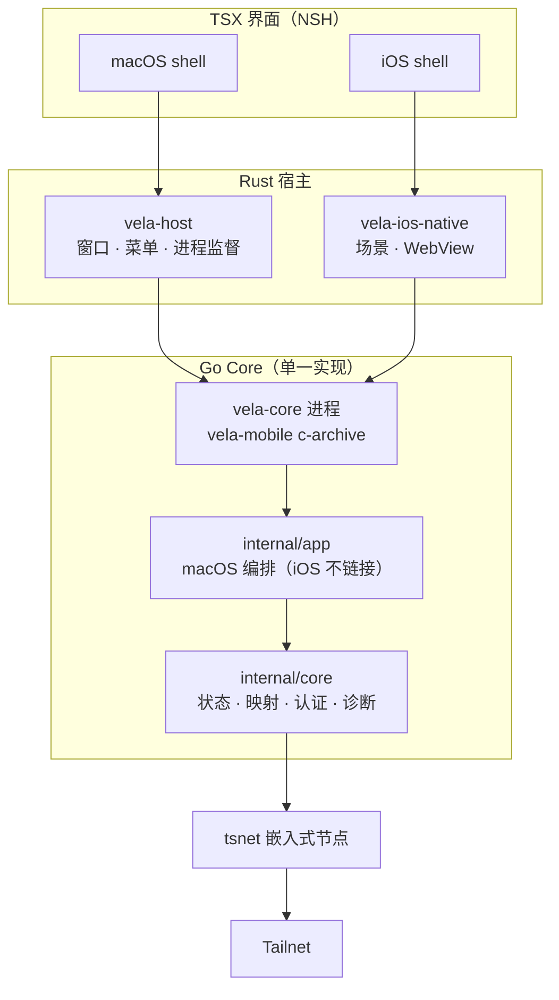
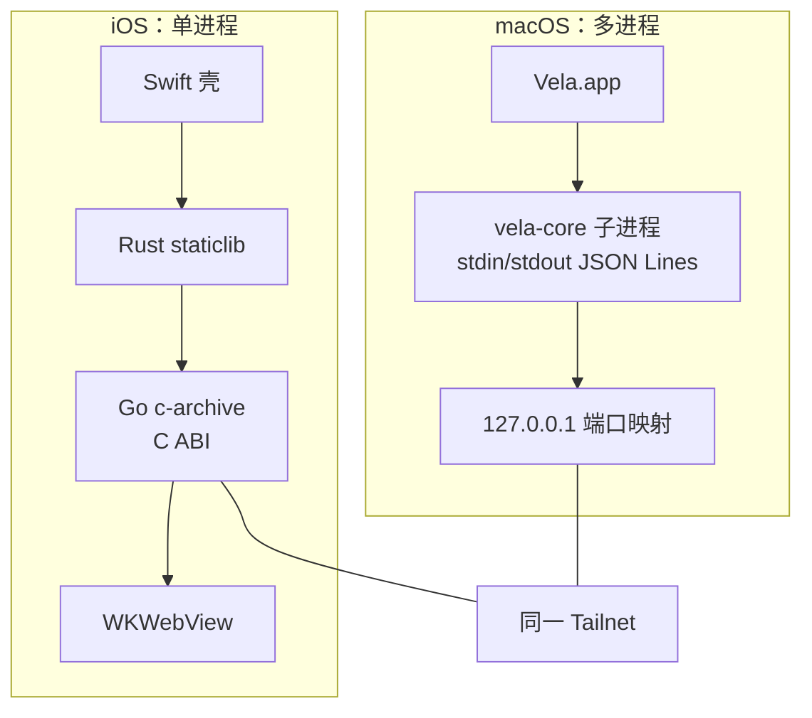
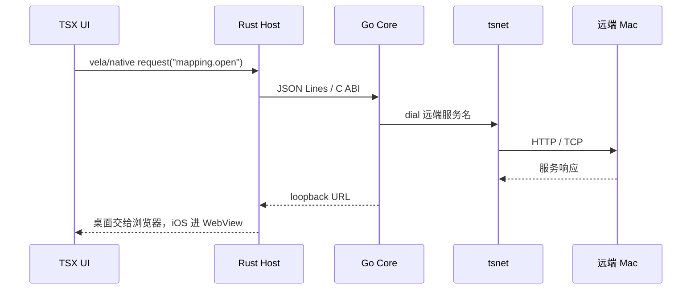

Vela 让同一 Tailnet 里的设备访问你 Mac 上共享的本地服务：桌面端负责共享、转发和诊断，iPhone 端只读浏览。两端共用一套控制协议、一份 Core 实现和一层纯函数投影。

本文只讲架构和关键取舍，完整使用说明见仓库 `packages/apps/vela/docs/`。

## 为什么用 NSH

[nsh.dev](https://nsh.dev) 是 Rust first 的原生 UI 框架：每个平台使用系统自己的控件（macOS 用 AppKit，iOS 用 UIKit），TSX 负责快速写界面。Vela 选它有三个原因：

- **一套逻辑，两份密度**：业务、协议和状态共享，布局与间距按桌面和触控分别实现。
- **Rust 宿主可直接扩展**：通过 native module 把 C ABI、WebKit 和原生控件接进 TSX。
- **单一工具链**：`nsh build / check / run` 产出 `bundle.nshc`，塞进签名 App 即可。

## 技术栈

| 层 | 选型 |
| --- | --- |
| 界面 | NSH 0.2.0 · TSX · Tailwind tokens |
| 宿主 | Rust 1.98.1 · AppKit / UIKit / WKWebView |
| 核心 | Go 1.27.2 · `tailscale.com/tsnet` 1.104.1 |
| 通信 | JSON Lines 控制协议 v1；iOS 走 C ABI |
| 系统 | macOS 14+ · iOS 17+ |

## 架构



依赖方向只有一条：`macos/**, ios/** → shared/**, core/**`，反向由结构测试和 `verify-ios-deps.sh` 拦住。

## 双端运行模型



macOS 把 Core 作为 `Contents/Helpers/vela-core` 辅助进程，父进程通过管道管生命周期；iOS 不能 fork，`vela-mobile` 编译成 c-archive，由 Rust 宿主经 C ABI 调用。Core 是 `config.json` 的唯一写入者，UI 只能通过协议读写。

## 一次打开服务的流程



Core 为每个「设备 + 服务」开一个 loopback 监听，引用计数归零才关闭；端口会记住上次的选择。iOS 进入后台时 `suspend` 关闭所有监听，回到前台 `resume` 重建映射，失败则重新加载页面。

## 关键实现

**TSX 调 Rust。** 宿主用 `#[module]` 暴露能力，TSX 侧声明成 `vela/native`：

```rust
#[module]
impl CoreBridge {
    pub async fn request(kind: String, payload: String) -> Result<String, String> {
        // C ABI / 子进程调用，错误转成 Err
    }
}
```

**共享层只放纯逻辑。** `shared/ui` 是协议类型、client 工厂和纯函数投影；`shared/protocol/fixtures` 同时约束 Rust 与 Go；`shared/tokens` 是品牌色唯一真源。两端共享计算，不共享组件。

**NSH 的响应式约束。** 派生值必须写成 getter——框架重跑的是 binding，不是组件体。这是移植界面时最容易踩的坑。

**数据边界。** 写操作只在 `Application Support/vela/`（`config.json`、`network/`、`web-data/`）；不装 TUN、不请求 root、不写系统代理或路由，Core 只连白名单内的 loopback 服务。

## 构建与发布

```text
macos/ui/App.tsx ──nsh build──▶ bundle.nshc ─┐
macos/host       ──cargo────▶ Vela           ├─▶ Vela.app（签名）
core/cmd/vela-core ──go─────▶ Helpers/vela-core ┘

ios/ui/App.tsx   ──nsh build──▶ bundle.nshc ─┐
ios/host         ──cargo────▶ staticlib      ├─▶ Xcode ─▶ Vela.app
core/cmd/vela-mobile ──go───▶ c-archive ──▶ xcframework ┘
```

macOS 一条 `pnpm -F vela build:app` 完成组装与签名。iOS 先构建 device / simulator 两个 slice 打包成 `VelaCore.xcframework`，再由 Xcode 链接 Swift 壳、Rust 宿主和 Go Core。

免费个人签名 7 天过期，到期需覆盖安装；**不要删除 App**，否则容器里的 tsnet 身份和 WebView Cookie 会一起丢失。

## 验证

`pnpm -F vela verify` 是唯一入口：结构测试守依赖方向，协议 fixtures 守两端一致，Rust 做 format/test/clippy，Go 跑 race，iOS 额外校验依赖边界。发布前再跑 `verify:release`，追加两端组包与签名。

## 常见问题

**键盘弹出后页面被遮挡怎么办？**

WebView 的底边不能低于 `UIKeyboardLayoutGuide.topAnchor`：常态底部约束用优先级 999，键盘约束设为 required。不要监听键盘通知手动改 frame，也不要写 `contentInset`、`obscuredContentInsets` 或 `contentOffset`。iOS 26 下这些补偿会让布局视口和视觉视口不同步，表现为整页上移或状态栏被盖住。

**收起键盘后布局没有恢复？**

同样不要手动还原 frame。键盘消失后约束系统会自动把 WebView 放回常态边界（底部 84pt）；只要键盘约束是 required、常态约束是 999，就会自然过渡。页面里也不要用 `visualViewport` 或 DOM transform 做位移补偿，否则关闭键盘后会残留空白或偏移。

**服务列表里看不到 Mac 共享的服务？**

确认两台设备在同一个 Tailnet、Mac 上的 Vela 正在运行且已开启共享，并让两端版本一致（清单版本不兼容会被过滤）。TCP 服务在 iOS 上只显示为「不支持」，不会出现在可打开列表里。

**macOS 的 Cookie / localStorage 怎么保持稳定？**

转发地址不用裸 `127.0.0.1`，而是每个「服务 + 设备」一个 `<服务>-<设备>.localhost` 主机名。`.localhost` 按 RFC 6761 直接解析到 loopback，不用改 hosts，也仍然是 secure context；Cookie 只按 host 隔离、忽略端口，这样两台 Mac 上的同名服务不会互相覆盖登录态。端口会写进 `config.json` 的 `mappingPorts`，下次优先复用，origin 不变，系统浏览器里的 Cookie / localStorage 就能一直沿用。

**iOS 回到前台后怎么重建网络？**

后台不提供访问是设计约束。进入后台时 `vela_core_suspend` 关闭所有 loopback 监听，但保留 tsnet 身份和映射的 key / 端口；回前台 `vela_core_resume` 按原顺序重开映射，优先复用记住的端口，origin 不变。WebView 的数据存储按「设备 + 服务」派生固定 UUID（`WKWebsiteDataStore.dataStoreForIdentifier`），因此 Cookie / localStorage 不会丢。个别端口被占用导致重开失败时，宿主会在回到 active 后重新加载当前页面。

**页面白屏或加载失败？**

先点舞台上的「重新加载」。Debug 构建可以连上 Safari Web Inspector 看控制台，重点检查 SSE / WebSocket 和 Cookie。

## 小结

Vela 的分工很清晰：NSH + Rust 负责「像原生一样显示和交互」，Go Core 负责「网络与状态」，共享层负责「两端不漂移」。想继续深入，可以看 nsh.dev 的文档和 Vela 仓库里的 `docs/architecture.md`、`docs/protocol.md`、`docs/ios.md`。
